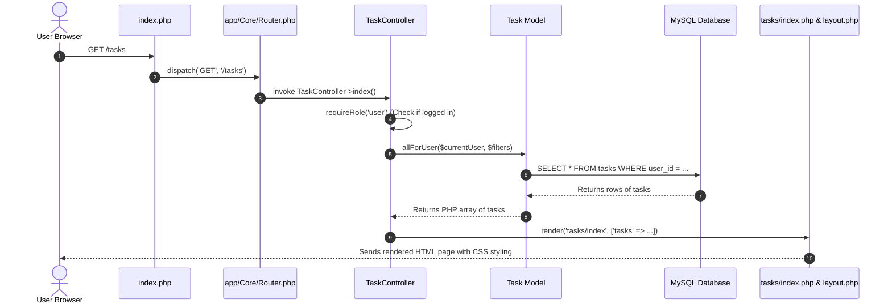
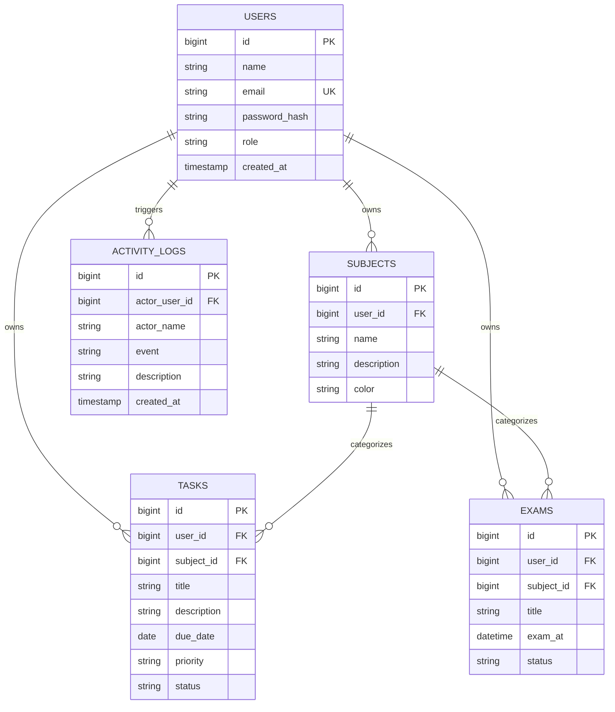

# StudyPlanner: Complete Beginner-Friendly Codebase Guide

Welcome to **StudyPlanner**! This document explains **every single part of this project in plain, layman-friendly language**. Even if you are completely new to web development, PHP, or databases, this guide will take you step-by-step through how everything works and how all the files talk to each other.

---

## Table of Contents
1. [The Big Picture: What is StudyPlanner?](#1-the-big-picture-what-is-studyplanner)
2. [The Restaurant Metaphor: Understanding MVC](#2-the-restaurant-metaphor-understanding-mvc)
3. [The Request Journey: How a Click Becomes a Web Page](#3-the-request-journey-how-a-click-becomes-a-web-page)
4. [Project Directory Tour](#4-project-directory-tour)
5. [Deep Dive: File-by-File & Code-by-Code Explanation](#5-deep-dive-file-by-file--code-by-code-explanation)
   - [A. Entry Point & Configuration](#a-entry-point--configuration)
   - [B. Helper Functions (`app/helpers.php`)](#b-helper-functions-apphelpersphp)
   - [C. Core Engine (`app/Core/`)](#c-core-engine-appcore)
   - [D. Data Models (`app/Models/`)](#d-data-models-appmodels)
   - [E. Controllers (`app/Controllers/`)](#e-controllers-appcontrollers)
   - [F. Views & Layouts (`app/Views/`)](#f-views--layouts-appviews)
   - [G. Frontend Styling & JavaScript (`public/assets/`)](#g-frontend-styling--javascript-publicassets)
   - [H. Database & Schema (`db/`)](#h-database--schema-db)
   - [I. Automated Smoke Tests (`tests/`)](#i-automated-smoke-tests-tests)
6. [Security in Plain English: How the App Protects Itself](#6-security-in-plain-english-how-the-app-protects-itself)
7. [Step-by-Step Flow Example: Creating a Study Task](#7-step-by-step-flow-example-creating-a-study-task)
8. [How to Run & Test the Application](#8-how-to-run--test-the-application)

---

## 1. The Big Picture: What is StudyPlanner?

**StudyPlanner** is a web application designed to help students organize their academic life:
- **Subjects**: Courses or classes (e.g., Mathematics, Computer Science, Biology) with custom color tags.
- **Tasks**: Homework, assignments, or study milestones with due dates, priority levels (*low, medium, high*), and statuses (*pending, in_progress, completed*).
- **Exams**: Important upcoming test dates and schedules.
- **Progress Tracking**: A dashboard that calculates what percentage of tasks you have completed.
- **User Roles & Privacy**: Each student has their own private account; nobody else can see their study records.
- **Admin Workspace**: An administrator can view system statistics, create or delete user accounts, review student data, and inspect a full security and activity log.

---

## 2. The Restaurant Metaphor: Understanding MVC

StudyPlanner is structured using an industry-standard software design pattern called **MVC** (**M**odel-**V**iew-**C**ontroller). 

Think of MVC like a well-organized dining restaurant:

```
  [User / Customer]
         │ (Places order by clicking a link / submitting a form)
         ▼
    [Controller]  <--- The Waiter (Takes the order, validates it, decides what to do)
      │       │
      │       │ (Asks for ingredients / data)
      │       ▼
      │   [Model] <--- The Chef (Interacts with the Pantry / MySQL Database)
      │       │
      │       │ (Returns cooked food / fetched data)
      │       ▼
      └──> [View] <--- The Plating / Dish (Puts food into pretty plates / HTML web page)
              │
              ▼
    [Browser Display] (The customer receives their delicious meal!)
```

1. **The Controller (The Waiter)**:
   - Listens to what the user wants (e.g., "Show me my tasks" or "Delete this subject").
   - Makes sure the user is allowed to do that (checks login session).
   - Asks the Model to fetch or change the data.
   - Tells the View which web page template to display.
2. **The Model (The Chef & Pantry Manager)**:
   - Knows the database inside out.
   - Runs SQL queries to create, read, update, or delete records.
   - Never touches HTML directly.
3. **The View (The Plating & Presentation)**:
   - Takes the raw data given by the Controller and formats it into HTML buttons, cards, tables, and colors.
4. **The Router (The Host at the Front Door)**:
   - Greets incoming visitors and directs them to the right waiter (Controller). For instance, if someone asks for `/login`, the Router sends them to `AuthController`.

---

## 3. The Request Journey: How a Click Becomes a Web Page

When you open `http://localhost:8000/tasks` in your web browser, here is the exact relay race that happens in milliseconds:



---

## 4. Project Directory Tour

Here is a map of the folders in this repository:

```
webtech/
├── app/
│   ├── Controllers/    # The Waiters (Handle requests, validate inputs, choose views)
│   ├── Core/           # The Engine (Router, Database PDO connection, Base Controller)
│   ├── Models/         # The Data Managers (Talk directly to MySQL)
│   ├── Views/          # The HTML Templates (What you see on the screen)
│   └── helpers.php     # Global utility functions (security, escaping, sessions)
├── config/
│   └── database.php    # Database connection settings (host, port, user, password)
├── db/
│   ├── schema.sql      # Database blueprint (tables, columns, foreign keys)
│   ├── create_admin.php# Command-line script to create an admin account
│   └── migrations/     # Incremental updates to database schema
├── public/
│   └── assets/
│       ├── css/app.css # All visual styling, responsive design, animations
│       └── js/app.js   # Client-side validation, SweetAlert modals, mobile menus
├── routes/
│   └── web.php         # The URL roadmap (links paths like /login to Controllers)
├── tests/
│   └── form_validation_smoke.php # Automated tests checking 48 safety checks
├── index.php           # The single front-door entry point for all web requests
└── README.md           # Quick setup notes
```

---

## 5. Deep Dive: File-by-File & Code-by-Code Explanation

---

### A. Entry Point & Configuration

#### 1. [index.php](file:///c:/Users/pandi/Documents/AyushCodes/webtech/index.php)
- **Role**: The "Front Controller". Every single request to the website passes through this file first.
- **Key Code**:
  - `session_start()`: Starts or resumes the user's browser session (so the app remembers if you are logged in).
  - `require` statements: Loads all core classes, models, and controllers into memory.
  - `$router = new App\Core\Router()`: Initializes the URL router.
  - `require __DIR__ . '/routes/web.php'`: Loads the list of registered URL routes.
  - `$router->dispatch(...)`: Inspects the requested URL and HTTP method (GET or POST) and executes the matching controller.

#### 2. [config/database.php](file:///c:/Users/pandi/Documents/AyushCodes/webtech/config/database.php)
- **Role**: Configuration file for connecting to the database.
- **Key Code**:
  - Checks if a `.env` file exists. If so, parses key-value pairs.
  - Provides sensible default settings:
    - Host: `127.0.0.1`
    - Port: `3306`
    - Database Name: `studyplanner`
    - Username: `root`
    - Password: `""` (empty)
  - Returns an array with these credentials for the database connector to use.

---

### B. Helper Functions (`app/helpers.php`)

[app/helpers.php](file:///c:/Users/pandi/Documents/AyushCodes/webtech/app/helpers.php) contains handy global helper functions used across the whole application:

- `e(?string $value)`:
  - **What it does**: Escapes dangerous characters using `htmlspecialchars(...)`.
  - **Why it matters**: Protects against **Cross-Site Scripting (XSS)**. If an attacker names a subject `<script>alert("hacked")</script>`, `e()` turns it into harmless text `&lt;script&gt;...` so the browser does not execute malicious scripts.
- `sanitize_text_value(?string $value)`:
  - Strips invisible control characters, extra whitespace, and HTML tags to keep user input clean and uniform.
- `is_valid_person_name(string $value)`:
  - Ensures a person's name only has valid alphabetical letters and spaces.
- `current_user()`:
  - Quickly retrieves the currently logged-in user array from `$_SESSION['user']`, or `null` if not logged in.
- `csrf_token()` & `csrf_field()`:
  - Generates a secret random 64-character token stored in the user's session.
  - Produces `<input type="hidden" name="_token" value="...">` to embed into every HTML form to prevent unauthorized third-party websites from submitting forms on behalf of the user (**Cross-Site Request Forgery**).
- `flash(string $key, ?string $message = null)`:
  - Stores a temporary notification in the session (e.g., *"Task added successfully"*). As soon as the page displays it, it gets deleted from memory so it won't appear twice.
- `password_meets_policy(string $password)`:
  - Enforces strong password rules: 8 to 72 characters, at least one uppercase letter, one lowercase letter, one number, and one special symbol.

---

### C. Core Engine (`app/Core/`)

#### 1. [app/Core/Database.php](file:///c:/Users/pandi/Documents/AyushCodes/webtech/app/Core/Database.php)
- **Role**: Manages the database connection using PHP Data Objects (PDO).
- **Design Pattern**: **Singleton Pattern**. Instead of opening a new database connection every time a query is executed (which would slow down the computer), `Database::connection()` opens the connection once and reuses the exact same `$connection` instance throughout the entire request.
- **Safety**: Sets `PDO::ATTR_ERRMODE => PDO::ERRMODE_EXCEPTION` so any database mistake throws an immediate clear error instead of failing silently. Sets `PDO::ATTR_EMULATE_PREPARES => false` to ensure true server-side prepared statements that stop SQL Injection.

#### 2. [app/Core/Router.php](file:///c:/Users/pandi/Documents/AyushCodes/webtech/app/Core/Router.php)
- **Role**: The traffic controller.
- **Methods**:
  - `get($path, $action)` & `post($path, $action)`: Registers routes.
  - `add($method, $path, $action)`: Converts user-friendly route paths like `/subjects/{id}` into regular expression patterns like `~^/subjects/(?P<id>[1-9][0-9]*)$~`.
  - `dispatch($method, $requestPath, $basePath)`: Compares the incoming URL against registered patterns. When a match is found, it extracts arguments (like `{id}`) and calls the Controller method. If no match is found, it outputs a clean `404 Page not found`.

#### 3. [app/Core/Controller.php](file:///c:/Users/pandi/Documents/AyushCodes/webtech/app/Core/Controller.php)
- **Role**: The parent class that all controllers inherit from.
- **Shared Capabilities**:
  - `render($view, $data)`: Takes the name of a view template (e.g., `tasks/index`), unpacks variables, captures the generated HTML in an output buffer (`ob_start()`), and injects it into `layout.php`.
  - `requireAuth()`: Guards pages. If the visitor is not logged in, redirects them immediately to `/login` with a helpful message.
  - `requireRole($role)`: Ensures students cannot access admin pages, and admins visiting student pages are handled properly.
  - `requireGuest()`: Ensures already-logged-in users visiting `/login` or `/signup` are redirected straight to their dashboard.
  - `requireCsrf()`: Inspects POST submissions to verify that the submitted `_token` matches the user's secret session token.

---

### D. Data Models (`app/Models/`)

Models are the only files in the project that speak directly to the MySQL database.

#### 1. [app/Models/User.php](file:///c:/Users/pandi/Documents/AyushCodes/webtech/app/Models/User.php)
- `findByEmail($email)`: Looks up an account by email to verify login credentials.
- `create($name, $email, $password)`: Hashes the password using `password_hash($password, PASSWORD_DEFAULT)` (bcrypt) and inserts a new row into the `users` table.
- `allWithSummaries()`: Used by the admin dashboard to list all registered users along with their count of subjects and completed tasks.
- `deleteUser($id)`: Deletes a user account. Thanks to `ON DELETE CASCADE` in MySQL, all subjects and tasks belonging to that user are cleaned up automatically.

#### 2. [app/Models/Subject.php](file:///c:/Users/pandi/Documents/AyushCodes/webtech/app/Models/Subject.php)
- `allForUser($user)`: Retrieves all subjects owned by the logged-in student, calculating how many tasks exist for each subject and how many are completed.
- `create($attributes)`: Saves a new subject with its name, description, and color code (e.g., `#26745c`).
- `nameExistsForUser($userId, $name)`: Prevents a student from creating two subjects with the exact same name.
- `updateForUser(...)` & `deleteForUser(...)`: Safely edits or deletes a subject while guaranteeing that a user can only edit their *own* records (`WHERE user_id = :user_id`).

#### 3. [app/Models/Task.php](file:///c:/Users/pandi/Documents/AyushCodes/webtech/app/Models/Task.php)
- `allForUser($user, $filters)`: Fetches study tasks with optional filtering by status (*pending*, *in_progress*, *completed*) or by subject. Orders tasks intelligently so pending tasks with closest deadlines appear first, while completed tasks stay at the bottom.
- `create($attributes)`: Inserts a new study task.
- `updateStatusForUser($id, $user, $status)`: Fast status update (e.g. marking a task completed with one click).
- `countsForUser($user)`: Calculates summary statistics (Total, Completed, Pending) for the dashboard progress cards.

#### 4. [app/Models/Exam.php](file:///c:/Users/pandi/Documents/AyushCodes/webtech/app/Models/Exam.php)
- `allForUser($userId)`: Fetches upcoming exams for a student joined with subject names and colors, sorted chronologically.
- `create(...)`, `updateForUser(...)`, `updateStatusForUser(...)`, `deleteForUser(...)`: Full management of exam dates, times, and statuses (*scheduled*, *completed*, *missed*).

#### 5. [app/Models/ActivityLog.php](file:///c:/Users/pandi/Documents/AyushCodes/webtech/app/Models/ActivityLog.php)
- `record($actor, $event, $description)`: Records important system events (e.g., `auth.login`, `task.created`, `user.deleted`). Stores who did it, what happened, and the exact timestamp.
- `latest($limit = 100)`: Allows administrators to review the security audit trail.

---

### E. Controllers (`app/Controllers/`)

Controllers are the coordinators. They inspect incoming forms, validate every field, call the Models, and pick the View to render.

- [AuthController.php](file:///c:/Users/pandi/Documents/AyushCodes/webtech/app/Controllers/AuthController.php):
  - Handles the public doors: `loginForm`, `login`, `registerForm`, `register`, and `logout`.
  - Regenerates session IDs (`session_regenerate_id(true)`) upon sign-in to protect against **session fixation attacks**.
- [HomeController.php](file:///c:/Users/pandi/Documents/AyushCodes/webtech/app/Controllers/HomeController.php):
  - Powers the student homepage overview (`/`). Gathers progress counts, subject cards, and the 5 most urgent upcoming tasks.
- [SubjectController.php](file:///c:/Users/pandi/Documents/AyushCodes/webtech/app/Controllers/SubjectController.php):
  - Handles adding, editing, viewing, and deleting subjects. Validates that colors match the approved color palette.
- [TaskController.php](file:///c:/Users/pandi/Documents/AyushCodes/webtech/app/Controllers/TaskController.php):
  - Manages task creation, editing, status toggling, and filtering. Validates date formats and priority levels.
- [ExamController.php](file:///c:/Users/pandi/Documents/AyushCodes/webtech/app/Controllers/ExamController.php):
  - Manages exam schedules, validating dates and ensuring the selected subject belongs to the student.
- [ProgressController.php](file:///c:/Users/pandi/Documents/AyushCodes/webtech/app/Controllers/ProgressController.php):
  - Computes the percentage of completed study tasks and provides data for visual progress bars.
- [AdminController.php](file:///c:/Users/pandi/Documents/AyushCodes/webtech/app/Controllers/AdminController.php):
  - Restricts access strictly to users with the `admin` role.
  - Displays total system counts, provides an account management directory to add or delete students, and displays the activity log.

---

### F. Views & Layouts (`app/Views/`)

Views are clean PHP templates that output HTML.

#### [app/Views/layout.php](file:///c:/Users/pandi/Documents/AyushCodes/webtech/app/Views/layout.php)
- The **Master Shell** of the entire application.
- Contains the HTML `<head>`, loads CSS and JavaScript, and renders the header, sidebar, and user navigation.
- Injects `$content` (the specific view page) in the middle of the layout.
- Provides support for popup notifications via SweetAlert2.

#### Specific View Templates:
- `auth/login.php` & `auth/register.php`: Clean, distraction-free cards for authentication.
- `dashboard/index.php`: High-level summary dashboard with quick stats, subject badges, and upcoming tasks.
- `subjects/index.php`, `subjects/form.php`, `subjects/show.php`: Subject cards, color pickers, and course details.
- `tasks/index.php` & `tasks/form.php`: Interactive task list with filters and status-change buttons.
- `exams/index.php` & `exams/form.php`: Exam timeline cards.
- `progress/index.php`: Big percentage completion ring and breakdown of completed vs. pending tasks.
- `admin/index.php`, `admin/users.php`, `admin/user.php`, `admin/activity.php`: The administrator portal.

---

### G. Frontend Styling & JavaScript (`public/assets/`)

- [public/assets/css/app.css](file:///c:/Users/pandi/Documents/AyushCodes/webtech/public/assets/css/app.css):
  - A comprehensive CSS design system built without heavy external frameworks.
  - Features modern typography, clean cards, responsive layouts for both mobile phones and desktops, color-coded badges, and smooth hover animations.
- [public/assets/js/app.js](file:///c:/Users/pandi/Documents/AyushCodes/webtech/public/assets/js/app.js):
  - **Live Validation**: As you type in forms, it highlights requirements in real-time.
  - **SweetAlert2 Integration**: Converts browser alert and confirm boxes into smooth, accessible popups.
  - **Password Visibility Toggle**: The eye icon on password fields to reveal or hide typed text.
  - **Mobile Navigation Drawer**: Handles smooth slide-in navigation on mobile devices.

---

### H. Database & Schema (`db/`)

The database is built on MySQL/MariaDB with 5 relational tables defined in [db/schema.sql](file:///c:/Users/pandi/Documents/AyushCodes/webtech/db/schema.sql):



- **Foreign Keys with `ON DELETE CASCADE`**: When an account is removed, its private subjects, tasks, and exams are deleted cleanly so no orphan data remains.
- **`ON DELETE SET NULL` for Subjects**: If you delete a subject, its tasks and exams are kept safely with `subject_id = NULL` rather than being accidentally lost.

---

### I. Automated Smoke Tests (`tests/`)

File: [tests/form_validation_smoke.php](file:///c:/Users/pandi/Documents/AyushCodes/webtech/tests/form_validation_smoke.php)
- An automated integration test suite that simulates a real browser.
- Uses PHP cURL to send HTTP requests to the running server.
- Performs **48 distinct safety checks**:
  - Rejects empty, short, or invalid registrations.
  - Validates password strength rules and matching confirmations.
  - Tests XSS tag stripping on subjects and tasks.
  - Tests date validation and priority constraints.
  - Tests admin user creation and deletion.
  - Tests CSRF token rejection.
  - Cleans up all test rows from the database afterwards.

---

## 6. Security in Plain English: How the App Protects Itself

| Vulnerability Threat | What It Means | How StudyPlanner Protects You |
| :--- | :--- | :--- |
| **SQL Injection** | Attacker types SQL commands into input boxes to steal data. | **Prepared Statements**: All database operations use parameter bindings (`:id`, `:email`). MySQL treats input strictly as data, never as executable SQL. |
| **Cross-Site Scripting (XSS)** | Attacker inputs `<script>` tags to hijack sessions. | **`e()` and `sanitize_text_value()`**: All user-provided output is HTML-escaped before display, and inputs are stripped of tags. |
| **Cross-Site Request Forgery (CSRF)** | An evil website secretly tricks your browser into submitting forms. | **CSRF Tokens**: Every form includes a secret random token that must match the user's session token. |
| **Credential Theft** | Database leak exposing plain passwords. | **Bcrypt Hashing**: Passwords are never saved in plain text. They are hashed using `password_hash()` with secure salt. |
| **Privilege Escalation** | Regular students accessing admin panels or other students' data. | **Role Checks & User Scoping**: Controller checks `requireRole('admin')`, and all queries enforce `WHERE user_id = :user_id`. |

---

## 7. Step-by-Step Flow Example: Creating a Study Task

Let's follow what happens when you create a new task called *"Read Chapter 4"*:

1. **You Click "Add Task"**:
   - Browser sends `GET /tasks/create`.
   - `Router.php` routes request to `TaskController->createForm()`.
   - `TaskController` checks you are logged in, asks `Subject` model for your list of subjects, and displays `tasks/form.php`.
2. **You Fill the Form and Click "Save Task"**:
   - Browser sends `POST /tasks` with:
     - `_token`: `a9f82...` (CSRF token)
     - `title`: `Read Chapter 4`
     - `subject_id`: `3`
     - `due_date`: `2026-11-05`
     - `priority`: `high`
     - `status`: `pending`
3. **The Validation Guard (`TaskController->store`)**:
   - Checks `requireCsrf()`: Token matches session? Yes!
   - Checks `title`: Between 2 and 180 characters? Yes!
   - Checks `subject_id`: Belongs to you? Yes!
   - Checks `due_date`: Valid calendar date? Yes!
4. **The Database Insert (`Task->create`)**:
   - Prepares SQL: `INSERT INTO tasks (user_id, subject_id, title, due_date, priority, status) VALUES (...)`.
   - Binds your user ID and attributes safely.
   - MariaDB writes the new record to disk.
5. **Activity Log & Flash Message**:
   - `ActivityLog->record(...)` logs: *"Created task: Read Chapter 4"*.
   - `flash('success', 'Task added successfully.')`.
6. **Redirect & Render**:
   - Controller sends `Location: /tasks`.
   - Browser requests `GET /tasks`.
   - `TaskController->index()` fetches the updated task list and renders `tasks/index.php`.
   - SweetAlert popup displays: *"Task added successfully!"*

---

## 8. How to Run & Test the Application

### 1. The Easiest Way: One-Click Launch (`start.bat`)
Simply double-click [`start.bat`](file:///c:/Users/pandi/Documents/AyushCodes/webtech/start.bat) in the project root folder, or in your terminal run:
```cmd
.\start.bat
```
It will automatically check if MariaDB is running, start the PHP server, and open your browser!

### 2. Manual Commands (Step-by-Step)
If you prefer running commands manually, open PowerShell:

**Step A: Start the Database (MariaDB)**
```powershell
& "C:\Program Files\MariaDB 13.0\bin\mysqld.exe" --console
```
*(Leave this running in its window)*

**Step B: Start the PHP Web Server (in a new PowerShell window)**
```powershell
cd C:\Users\pandi\Documents\AyushCodes\webtech
php -S 127.0.0.1:8000 index.php
```

**Step C: Open Your Browser**
Navigate to:
👉 **http://127.0.0.1:8000/**

### 3. Login Credentials
An administrator account is already created and ready to use:
- **Admin Email**: `admin@studyplanner.test`
- **Admin Password**: `AdminPassword123!`

To test regular student features, click **Sign up** on the login page or register a new user.

### 4. Running the Automated Tests
To run the automated smoke test suite that verifies all 48 safety checks:
```powershell
$env:FORM_TEST_BASE_URL = "http://127.0.0.1:8000"
php tests/form_validation_smoke.php
```
